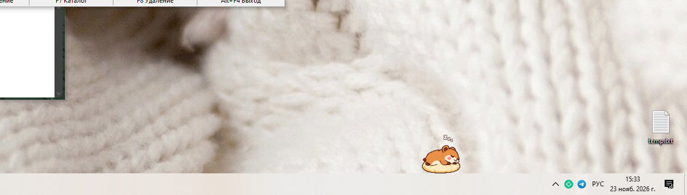

# 🐹 Зверушка на рабочем столе

Милый анимированный питомец для Windows — **хомячок, котик или скотч-терьер**.
Гуляет по панели задач, не мешает работе, реагирует на внимание, играет
и растёт в уровнях вместе с вами.

## ⬇️ Скачать и запустить

**[Скачать Zverushka.zip](https://github.com/iriksssss/zverushka-desktop-pet/releases/latest/download/Zverushka.zip)** (~101 МБ)

1. Распакуйте архив в любую папку.
2. Запустите `Zverushka.exe`.
3. Python устанавливать **не нужно** — всё уже внутри.

Зверушка появится на панели задач. Управление — через иконку в трее
(правый клик).

## ✨ Что умеет

| Ваше действие | Реакция |
|---|---|
| Клик | Радуется |
| Клик во сне | Просыпается с потягушками |
| 5+ кликов подряд | Злится (дым из ушей) |
| Двойной клик | Смущается и подпрыгивает |
| Навести курсор на 3 секунды | Умиляется, сердечки |
| Перетащить мышью | Висит «в руке», покачивается |
| Отпустить над окном | Падает на его кромку и гуляет по ней |
| Отпустить над рабочим столом | Падает обратно на панель задач |

Сама по себе: гуляет, сидит, иногда бежит, засыпает на подушке,
скучает без внимания, примерно раз в час говорит тёплую фразу
в облачке.

## 🎮 Игры и прогресс

- **Догонялки** — поймайте носящуюся по экрану зверушку;
- **Лакомства** — расставляйте печеньки, она их съедает;
- **Пузырьки** — лопайте мыльные пузыри вокруг неё;
- уровни, титулы (от «Новичка» до «Легенды рабочего стола»),
  26 достижений, стрик дней — в меню «Прогресс».

## 🛠 Не мешает работе

Окно полноэкранное прозрачное и «прокликивается» насквозь везде,
кроме тела зверушки; не попадает в Alt-Tab; не отображается
на панели задач как окно. Пауза и «Спрятать» — в меню трея.

## 👩‍💻 Разработчикам

Исходный код — в этом репозитории (Python 3.13 + PySide6, win32 ctypes).
Документация по архитектуре, сборке (PyInstaller onedir), тестам
и истории разработки: [docs/DEVELOPMENT.md](docs/DEVELOPMENT.md)
и [docs/BRIEFING.md](docs/BRIEFING.md).

## Лицензия

Для личного использования, свободно.
