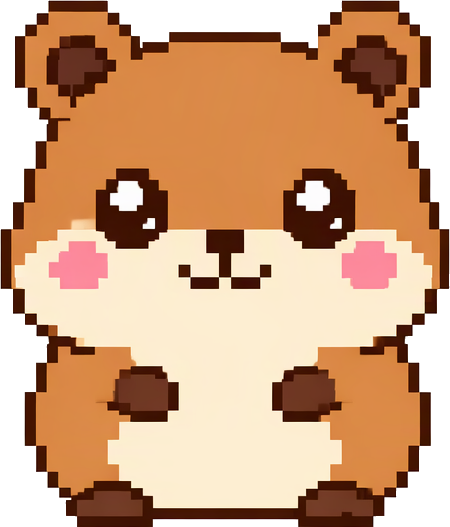
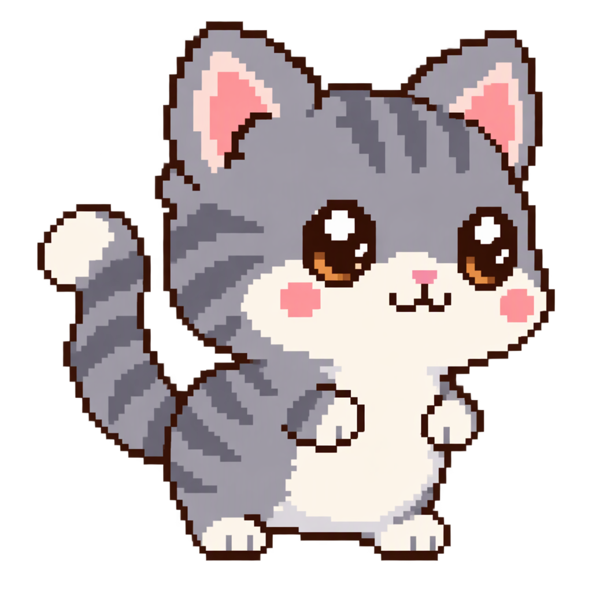
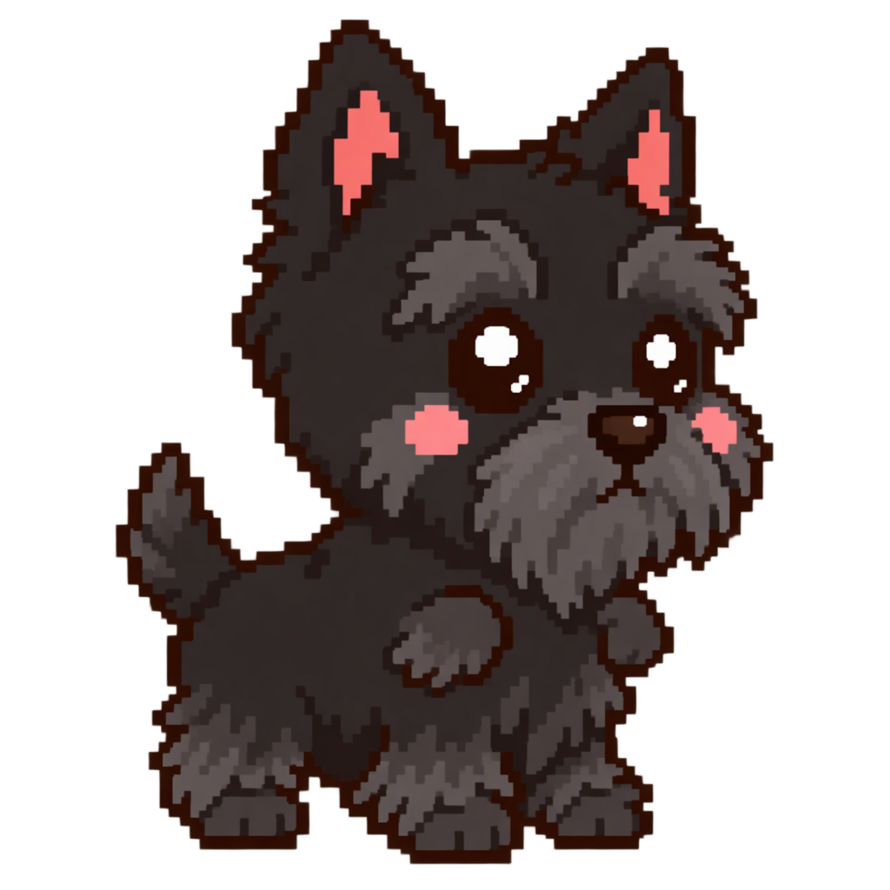

# 🐹 Зверушка на рабочем столе

Милый анимированный питомец для Windows — **хомячок, котик или скотч-терьер**.
Гуляет по панели задач, не мешает работе, реагирует на внимание, играет
и растёт в уровнях вместе с вами.

| 🐹 Хомячок | 🐱 Котик | 🐕 Скотч-терьер |
|---|---|---|
|  |  |  |

## ⬇️ Скачать и запустить

**[Скачать Zverushka.zip](https://github.com/iriksssss/zverushka-desktop-pet/releases/latest/download/Zverushka.zip)** (~101 МБ)

1. Распакуйте архив в любую папку.
2. Запустите `Zverushka.exe`.
3. Python устанавливать **не нужно** — всё уже внутри.

Зверушка появится на панели задач. Управление — через иконку в трее
(правый клик).

## ✨ Что умеет

| Ваше действие | Реакция |
|---|---|
| Клик | Радуется |
| Клик во сне | Просыпается с потягушками |
| 5+ кликов подряд | Злится (дым из ушей) |
| Двойной клик | Смущается и подпрыгивает |
| Навести курсор на 3 секунды | Умиляется, сердечки |
| Перетащить мышью | Висит «в руке», покачивается |
| Отпустить над окном | Падает на его кромку и гуляет по ней |
| Отпустить над рабочим столом | Падает обратно на панель задач |

Сама по себе: гуляет, сидит, иногда бежит, засыпает на подушке,
скучает без внимания, примерно раз в час говорит тёплую фразу
в облачке.

## 🎮 Игры и прогресс

- **Догонялки** — поймайте носящуюся по экрану зверушку;
- **Лакомства** — расставляйте печеньки, она их съедает;
- **Пузырьки** — лопайте мыльные пузыри вокруг неё;
- уровни, титулы (от «Новичка» до «Легенды рабочего стола»),
  26 достижений, стрик дней — в меню «Прогресс».

## ⚙️ Опции (меню в трее, правый клик по иконке)

- **Пауза** — заморозить зверушку на месте;
- **Спрятать / Показать** — убрать с экрана, не закрывая;
- **На панель задач** — вернуть зверушку «домой», если она гуляет
  по окну или по экрану;
- **Подбодри меня** — облачко с тёплой фразой по требованию;
- **Что умеет зверушка…** — подсказка: какие действия вызывают
  какие реакции;
- **Игры** — Догонялки / Лакомства / Пузырьки; любую игру можно
  прервать досрочно крестиком в правом верхнем углу экрана;
- **Прогресс** — уровень, титул, журнал достижений, статистика игр;
- **Уменьшить / Увеличить фигурку** — размер от 0.4× до 2.5×;
- **Питомец** — Хомячок / Котик / Скотч-терьер (переключение на лету);
- **Выход** — корректно закрывает приложение с сохранением настроек.

## 💬 Свои фразы для облачка

Фразы, которые зверушка показывает в облачке (раз в ~час и по кнопке
«Подбодри меня»), лежат в обычном текстовом файле рядом с программой:

```
assets\sprites\phrases.json
```

Формат — простой список строк:

```json
{
  "phrases": [
    "Ты сегодня чудесная.",
    "Я тут, рядом, поглядываю за тобой.",
    "Добавь сюда свою фразу!"
  ]
}
```

Правила: кодировка **UTF-8** (Блокнот сохраняет в ней по умолчанию),
каждая фраза — строка в кавычках, через запятую. После правки
перезапустите зверушку (трей → Выход, затем снова `Zverushka.exe`).
Если файл случайно испортить — зверушка не упадёт: включатся
встроенные запасные фразы.

## 🛠 Не мешает работе

Окно полноэкранное прозрачное и «прокликивается» насквозь везде,
кроме тела зверушки; не попадает в Alt-Tab; не отображается
на панели задач как окно. Пауза и «Спрятать» — в меню трея.

## 👩‍💻 Разработчикам

Исходный код — в этом репозитории (Python 3.13 + PySide6, win32 ctypes).
Сборка standalone-приложения: PyInstaller (onedir).

## Лицензия

Для личного использования, свободно.
